# Learned IGNITE Platform

## Architecture and constraints
- Preserve the exact high-level flow: targets and beam parameters → MAPE seed selector → `X`-iteration beam controller → learned modification mechanism → property estimation → uncertainty → scoring/ranking → best molecule.
- Preserve the modification flow: parent graph encoder + target-delta encoder → reaction-family/site/reagent selectors → RDKit SMARTS executor → validity filter → delta-property, uncertainty, and safety estimators → modification ranker.
- Treat outputs as computational candidates, not safety certification. Surface provenance, confidence intervals, hazard flags, and failed novelty checks; never collapse uncertainty into an unexplained “safe” label.
- Use React/TypeScript for the GUI, FastAPI/Pydantic for APIs, PyTorch Geometric for learned graph modules, RDKit for chemistry, PostgreSQL for durable runs/results, Redis plus a worker queue for long searches, and Docker Compose for local deployment.

```mermaid
flowchart LR
  UI["React GUI: targets and beam parameters"] --> API[FastAPI]
  API --> Queue[Search job queue]
  Queue --> SeedSelector[MAPE seed selector]
  SeedSelector --> BeamController[Beam search controller]
  BeamController --> ParentEncoder[Graph Transformer encoder]
  BeamController --> DeltaEncoder[Target delta encoder]
  ParentEncoder --> Planner["Reaction, site, reagent selectors"]
  DeltaEncoder --> Planner
  Planner --> Executor[RDKit SMARTS executor]
  Executor --> Validity[Validity and deduplication]
  Validity --> Estimation["Literature retrieval + XGBoost + delta model"]
  Estimation --> Risk["Uncertainty, safety, novelty"]
  Risk --> Ranker[Multi-objective ranker]
  Ranker --> BeamController
  Ranker --> Result[Best molecule plus audit trail]
```

## 1. Establish the application and contracts
- Create `backend/`, `frontend/`, `workers/`, `ml/`, `data/`, and `infra/` boundaries, dependency locks, environment schema, Docker Compose, and a root README.
- Define typed domain objects for target properties (`density`, `det_velocity`, `det_pressure`, `hf_solid`), beam depth `X`, expansion width `N`, survivor count `K`, MAPE threshold, candidate lineage, prediction source, uncertainty interval, safety findings, novelty evidence, and score breakdown.
- Add versioned endpoints: create/cancel a search, stream progress, retrieve candidate lineage/results, inspect model metadata, and export JSON/CSV/SDF. Validate physical ranges and enforce bounded beam parameters.
- Import the supplied diagrams into `docs/architecture/` and write an architecture traceability document mapping every box to one owned module.

## 2. Reconstruct and validate the property baseline
- Canonicalize and deduplicate [`sample_start_molecules.csv`](/home/josef/Projects/IGNITE/sample_start_molecules.csv), retain source-row lineage, handle incomplete property rows explicitly, and build canonical-SMILES/InChIKey indexes.
- Port and verify the descriptor contract from [`descriptors.py`](/home/josef/Projects/EnergeticGraph/descriptors.py) against all four existing checkpoints in [`models/`](/home/josef/Projects/IGNITE/models). Add model metadata containing descriptor order, units, training-data fingerprint, supported domain, and model version.
- Wrap absolute property predictors behind a source-aware estimator. Prefer exact experimental values, then close literature analogues, then XGBoost predictions; retain every source and confidence contribution rather than discarding it.
- Implement threshold-based multi-seed selection, replacing the sibling implementation’s single-nearest-seed behavior in [`modules/initialization.py`](/home/josef/Projects/EnergeticGraph/modules/initialization.py).

## 3. Build training data for the strict learned modification architecture
- Port the 34 reaction primitives and SMARTS variants from [`modules/strategy_pool.py`](/home/josef/Projects/EnergeticGraph/modules/strategy_pool.py), assign stable reaction-family/reagent IDs, atom-map reactions, and generate valid parent→child pairs from canonical seeds.
- Persist parent graph, child graph, reaction family, selected atom indices, fragment/reagent, edit distance, validity outcome, absolute predictions, and predicted property deltas. Split by molecular scaffold to prevent leakage.
- Acquire and normalize external reaction/property/hazard datasets where licensing permits; keep synthetic XGBoost-derived deltas marked as weak labels and measured values marked as ground truth. Do not train sensitivity or decomposition heads solely from SAScore proxies.
- Version generated datasets and record source licenses, hashes, generation config, and failed reactions. Add curation reports for class balance, duplicate leakage, property coverage, and applicability domain.

## 4. Train the learned planner and predictors
- Implement a Graph Transformer parent encoder, normalized numeric target-delta encoder, and joint latent representation.
- Train hierarchical heads in diagram order: reaction-family classifier → masked reactive-site selector → family-compatible reagent/fragment selector. Apply chemistry masks before sampling so impossible actions cannot enter the executor.
- Implement the RDKit reaction executor and hard validity filter: parse/sanitize, valence and allowed-element checks, connected-component policy, single-molecule policy, canonical deduplication, and removal of unchanged products.
- Train a multi-task delta-property predictor for the four required deltas; add sensitivity/decomposition outputs only after measured labels are available. Use the existing XGBoost models as absolute-property baselines and consistency checks, not as ground truth without provenance.
- Train uncertainty using deep ensembles plus conformal calibration on scaffold-held-out data. Combine epistemic/model uncertainty, literature-source reliability, analogue distance, and out-of-domain distance into per-property intervals.
- Train/calibrate a safety estimator from available hazard labels, with explicit heuristic fallback for unstable motifs and feasibility. Port only the useful RDKit/SAScore checks from [`modules/feasibility.py`](/home/josef/Projects/EnergeticGraph/modules/feasibility.py).
- Store immutable model bundles with architecture config, vocabulary, descriptor schema, calibration artifacts, metrics, and dataset versions.

## 5. Implement literature, patent, and novelty evidence
- Adapt the active retrieval path in [`modules/literature_search.py`](/home/josef/Projects/EnergeticGraph/modules/literature_search.py) and its cache, removing duplicate/dead retrieval paths. Query by canonical identifiers and close analogues, and preserve citations and extraction confidence.
- Create provider adapters for public chemistry databases, Crossref/OpenAlex-style literature metadata, and configured patent providers such as EPO OPS or Lens. Credentials remain optional; unavailable providers must yield an explicit “not checked,” never “novel.”
- Evaluate novelty in layers: exact canonical-SMILES/InChIKey match; maximum fingerprint similarity against seeds and curated energetic compounds; substructure/analogue search; literature mentions; patent claims/examples. Cache normalized evidence with timestamps and provider terms.
- Define a conservative novelty status (`known`, `close analogue`, `no match found`, `incomplete search`) plus a continuous novelty score. Patent/literature absence is evidence scope, not proof of legal novelty or patentability.

## 6. Implement beam search and unified ranking
- Adapt the controller shell from [`orchestrator.py`](/home/josef/Projects/EnergeticGraph/orchestrator.py), but make `N` the number of valid expansions per beam node, `K` the globally retained candidates per iteration, and `X` the hard depth limit.
- For each iteration: infer modifications, execute and filter products, estimate absolute/delta properties, retrieve evidence, compute uncertainty/safety/novelty, rank, deduplicate globally, and persist lineage. Support deterministic seeds, cancellation, budgets, partial failures, and progress events.
- Use a configurable normalized objective with a complete score breakdown: target MAPE + synthetic-accessibility penalty + uncertainty penalty + safety penalty + minimal-edit penalty. Apply hard rejection constraints for invalid chemistry and critical hazard rules; novelty is reported and can be configured as a gate or ranking preference.
- Stop on MAPE threshold, exhausted beam, convergence/patience, cancellation, or depth. Return top `K` and mark the top-scored candidate as the diagram’s final output.

## 7. Build the web GUI
- Create a target/beam form with units, range validation, presets, novelty-provider status, and safety disclaimer.
- Add live run progress showing current iteration, beam size, rejection counts, best MAPE, uncertainty, and cancellation controls.
- Render the best molecule and ranked alternatives as 2D structures with SMILES/InChIKey, predicted versus target values, calibrated intervals, source provenance, safety flags, novelty/patent/literature evidence, score components, and parent→child modification lineage.
- Support reproducible reruns and exports without exposing secrets or allowing arbitrary server-side paths/uploads.

## 8. Verification and release gates
- Unit-test canonicalization, MAPE edge cases, reaction masks/execution, validity filters, score monotonicity, uncertainty intervals, novelty status semantics, and API validation.
- Add scaffold-split ML evaluations for family/site/reagent top-k accuracy, valid-product rate, delta-property MAE, interval coverage, safety precision/recall, and retrieval evidence precision. Compare every learned component to rule-based/XGBoost baselines.
- Add integration tests for a bounded end-to-end beam search and frontend/API job lifecycle; include deterministic fixtures that do not require external providers.
- Gate deployment on model cards, dataset/license documentation, threat modeling for provider credentials and job limits, structured logs/metrics, database migrations, backups, and container health checks.

## Delivery sequence
1. Application contracts, data normalization, descriptor/model reconstruction.
2. Weak-supervision generator and external-data ingestion.
3. Learned planner, delta predictor, uncertainty and safety calibration.
4. Literature/patent novelty adapters and evidence model.
5. Beam controller, unified ranker, and persistent jobs.
6. GUI, end-to-end evaluation, documentation, and deployment hardening.