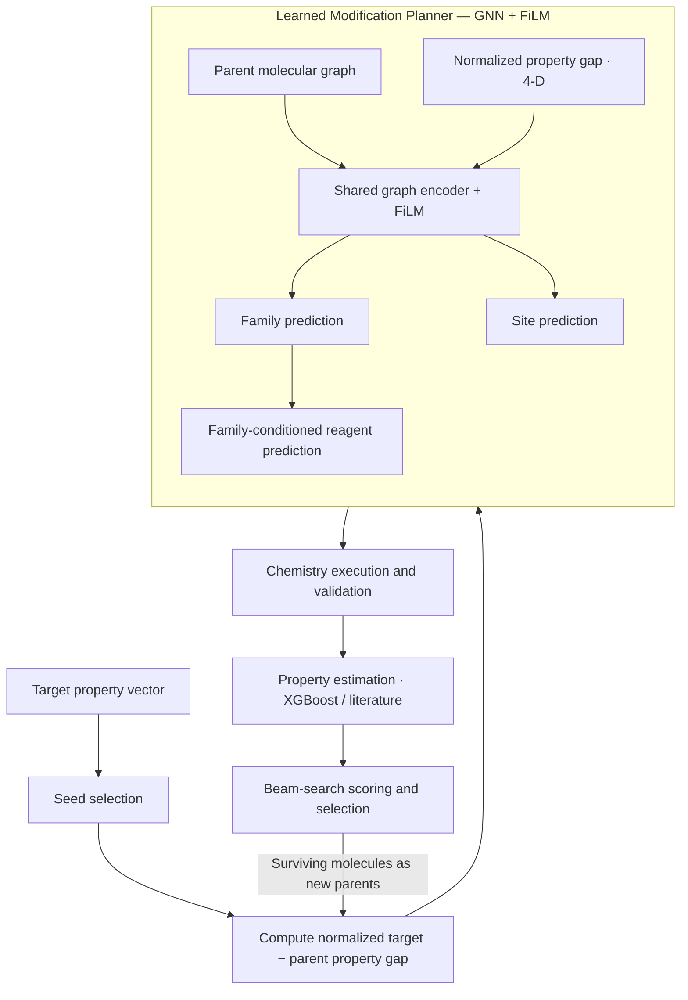
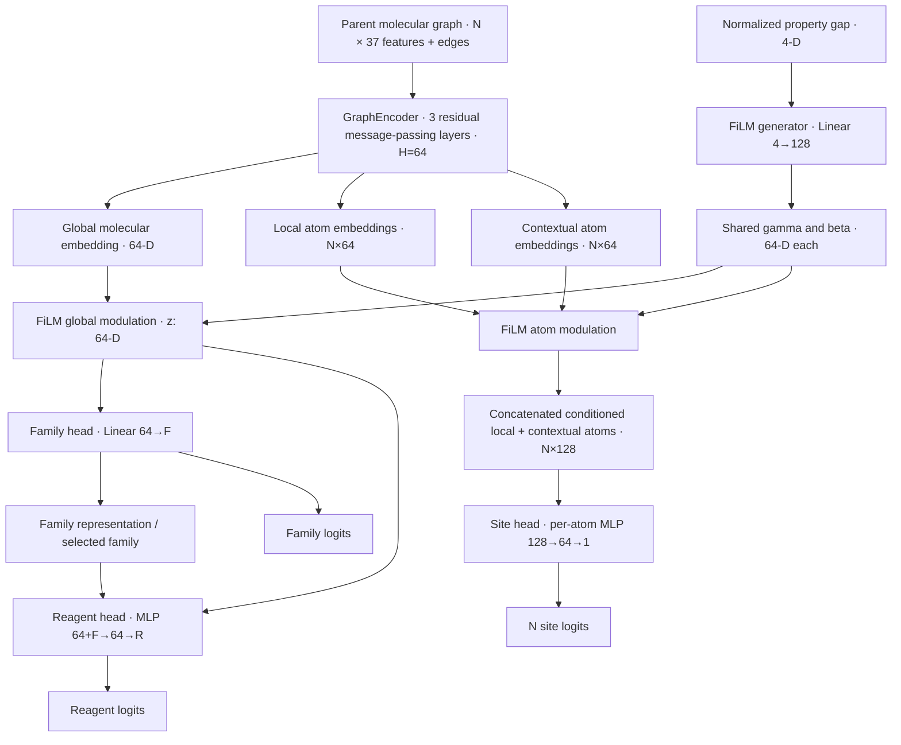
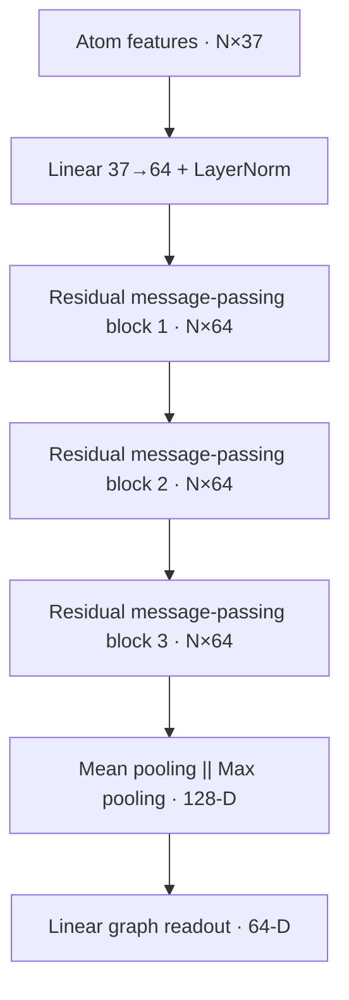
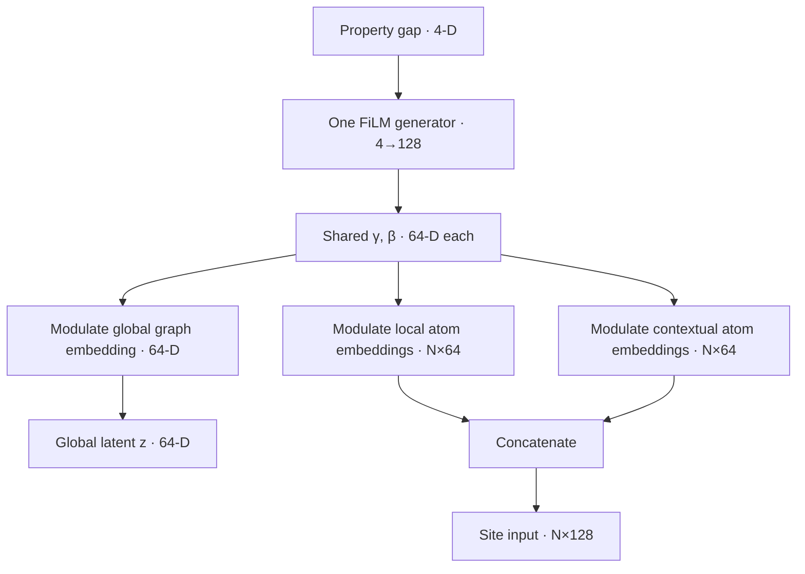
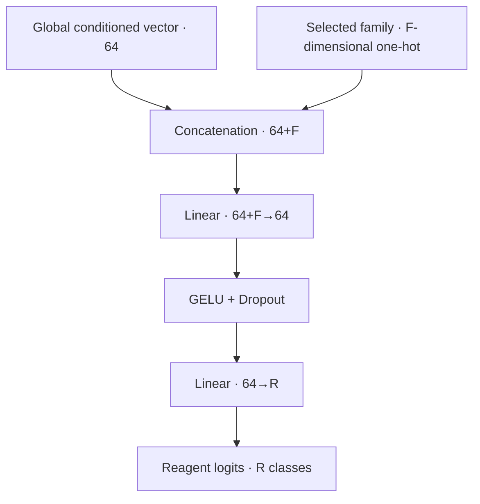
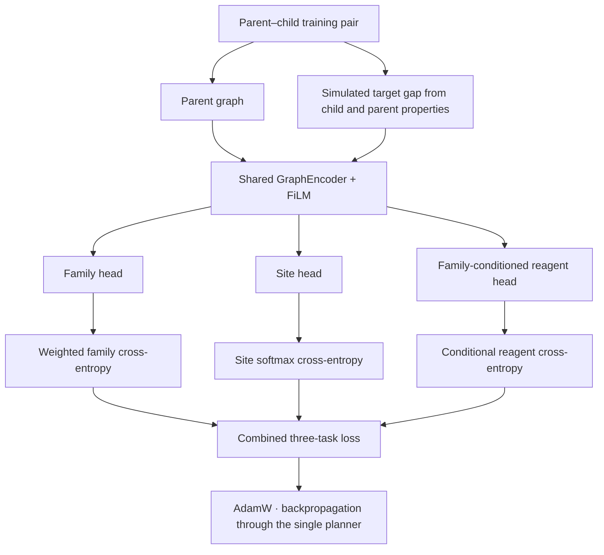
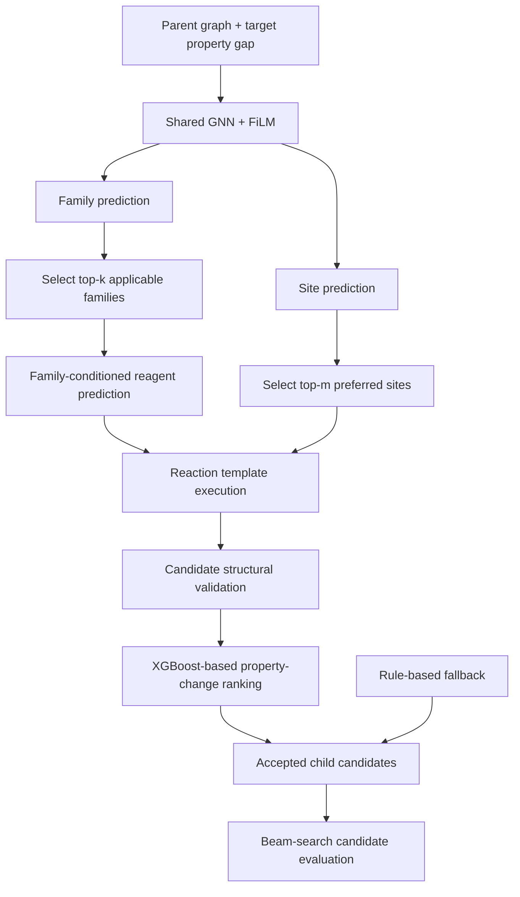

# IGNITE — Revised Planner Architecture

**Verified commit:** [`85aee991d5b9c83906d16f03e56e4eaf0b5227ea`](https://github.com/josefberman/IGNITE/tree/85aee99)  
**Repository:** `josefberman/IGNITE`  
**Date:** October 12, 2026

This description is based on the specified commit's neural architecture, training procedure, property-gap representation, and runtime modification mechanism.

The redesign is substantially simpler. IGNITE now uses **one property-conditioned graph neural network with three prediction heads**, without the auxiliary neural property-delta predictor or the more elaborate feature-fusion mechanisms.

The molecular representation is encoded once, conditioned once through FiLM, and passed to three lightweight prediction heads.

## 1. What changed?

| Component | Previous architecture | Commit `85aee99` |
|---|---|---|
| Graph encoder | 3-layer residual GNN | Unchanged |
| Property conditioning | FiLM + gap-aware atom attention + fusion | **Single FiLM layer** |
| Family head | Latent + raw property gap | Conditioned latent only |
| Site head | Local + contextual + global + gap | Conditioned local + contextual embeddings |
| Reagent head | Latent + family + gap + pooled atoms | Conditioned latent + family |
| Neural delta predictor | Separate dual-GNN model | **Removed** |
| Property-change ranking | Learned delta regressor | Existing XGBoost property estimators |
| Training losses | Four objectives | **Three classification objectives** |

This is a cleaner architecture with fewer independently learned representations and fewer paths by which conditioning information enters the model.

## 2. High-level system architecture

IGNITE is a goal-directed molecular design system. Its search loop begins with an existing molecule, determines which properties need to change, proposes modifications through a learned planner, evaluates resulting candidates, and repeats the procedure.

The target-property vector is

$$
\mathbf p^*=[\rho^*,D^*,P^*,H_f^*].
$$

The system-level architecture is largely unchanged. The main simplification occurs inside the learned planner, while chemical transformations, structural validation, property estimation, and beam search remain separate components.

The planner predicts *which modification to attempt* rather than generating the child molecule directly.

## 3. Planner architecture

**Implementation:** [ml/models/architectures.py](https://github.com/josefberman/IGNITE/blob/85aee99/ml/models/architectures.py)

The `ModificationPlanner` consists of a shared molecular graph encoder, a single Feature-wise Linear Modulation (FiLM) conditioning layer, a family classification head, a site localization head, and a family-conditioned reagent classification head.

### 3.1 Complete neural-network schematic

The site and family predictions share FiLM conditioning but are not sequentially dependent. The reagent head explicitly receives family information together with the global latent vector.

The mathematical form is:

$$
\begin{aligned}
(\mathbf g,H_{\mathrm{local}},H_{\mathrm{context}})&=\operatorname{GNN}(G),\\
(\gamma,\beta)&=\operatorname{FiLMGen}(\widetilde{\Delta\mathbf p}),\\
\mathbf z&=\operatorname{FiLM}(\mathbf g,\gamma,\beta),\\
H'&=\operatorname{FiLM}(H,\gamma,\beta),\\
\boldsymbol\ell_f&=f_{\mathrm{family}}(\mathbf z),\\
\boldsymbol\ell_s&=f_{\mathrm{site}}(H'),\\
\boldsymbol\ell_r&=f_{\mathrm{reagent}}(\mathbf z,\mathbf f).
\end{aligned}
$$

Here, $\mathbf f$ is the family-conditioning representation.

## 4. Low-level architecture

### 4.1 Molecular representation

A parent molecule is represented as $G=(V,E,X)$, with atoms $V$, bond connectivity $E$, and node features $X$. For $N$ atoms,

$$X\in\mathbb R^{N\times37}.$$

| Feature group | Dimensions | Description |
|---|---:|---|
| Atomic identity | 13 | Twelve specified elements plus unknown |
| Hybridization | 6 | SP, SP2, SP3, SP3D, SP3D2, other |
| Atomic attributes | 12 | Charge, degree, valence, hydrogens, mass, aromaticity, chirality, etc. |
| Ring indicators | 6 | Membership in rings of sizes 3–8 |
| **Total** | **37** | |

`mol_to_graph()` uses RDKit to construct these features and a bidirectional edge index. No explicit bond-order features, molecular coordinates, or 3D geometric descriptors enter the GNN.

### 4.2 Shared GraphEncoder

Initial atom embedding:

$$H^{(0)}=\operatorname{LN}(W_{\mathrm{in}}X+b_{\mathrm{in}}).$$

The neighbor mean for atom $i$ in layer $l$ is:

$$
\mathbf m_i^{(l)}=
\frac{1}{\max(1,|\mathcal N(i)|)}\sum_{j\in\mathcal N(i)}\mathbf h_j^{(l)}.
$$

Residual update:

$$
\tilde{\mathbf h}_i^{(l+1)}=\mathbf h_i^{(l)}+
\operatorname{LN}\!\left[\operatorname{GELU}\!\left(
W_s^{(l)}\mathbf h_i^{(l)}+W_n^{(l)}\mathbf m_i^{(l)}+b^{(l)}
\right)\right].
$$

Dropout is then applied:

$$\mathbf h_i^{(l+1)}=\operatorname{Dropout}(\tilde{\mathbf h}_i^{(l+1)}).$$

After three blocks, a contextual embedding can incorporate information from up to three bonds away.

Graph-level readout:

$$
\mathbf g=W_g\left[\operatorname{MeanPool}(H^{(3)})\Vert\operatorname{MaxPool}(H^{(3)})\right]+b_g.
$$

Three representations are retained:

| Representation | Dimension | Purpose |
|---|---|---|
| $\mathbf g$ | 64 | Global molecular context |
| $H^{(0)}$ | $N\times64$ | Local atomic information |
| $H^{(3)}$ | $N\times64$ | Contextual atomic information |

Local embeddings preserve atom-specific features, while contextual embeddings incorporate information from neighboring atoms. This distinction is especially relevant for site localization.

### 4.3 Single FiLM conditioning layer

The new architecture introduces the property gap **exclusively through one FiLM generator**, rather than through multiple attention and feature-fusion paths.

Raw gap:

$$\Delta\mathbf p=\mathbf p^*-\hat{\mathbf p}.$$

| Property | Normalization scale |
|---|---:|
| Density | 1.0 |
| Detonation velocity | 1,000 |
| Detonation pressure | 10 |
| Solid heat of formation | 100 |

The resulting signed normalized vector is clipped to $[-1,1]$, with a deadband equal to 1% of the corresponding scale:

$$\widetilde{\Delta\mathbf p}\in[-1,1]^4.$$

One linear projection creates scale and shift parameters:

$$
[\gamma\Vert\beta]=W_{\mathrm{FiLM}}\widetilde{\Delta\mathbf p}+b_{\mathrm{FiLM}},
\qquad \mathbb R^4\rightarrow\mathbb R^{128},
$$

with $\gamma,\beta\in\mathbb R^{64}$.

For any 64-dimensional embedding,

$$\operatorname{FiLM}(\mathbf h)=\mathbf h\odot(1+\gamma)+\beta.$$

The offset $1+\gamma$ permits modulation near identity when parameters are small.

The **same FiLM parameters** are applied to the graph embedding and both types of atom embeddings:

$$
\begin{aligned}
\mathbf z&=\mathbf g\odot(1+\gamma)+\beta,\\
\widetilde H_{\mathrm{local}}&=H^{(0)}\odot(1+\gamma)+\beta,\\
\widetilde H_{\mathrm{context}}&=H^{(3)}\odot(1+\gamma)+\beta,\\
H_{\mathrm{site}}&=[\widetilde H_{\mathrm{local}}\Vert\widetilde H_{\mathrm{context}}].
\end{aligned}
$$

The same parameters broadcast across all atoms. Modulation is property-dependent but is not independently generated for each atom. This creates shared conditioning across global and local representations without learned attention pooling.

## 5. Prediction heads

### 5.1 Family classification

The family head is a single linear projection:

$$\boxed{\boldsymbol\ell_f=W_f\mathbf z+b_f}.$$

Architecture: **64 → Linear → F family logits**, where $F$ is the number of broad transformation-family classes.

The raw property gap is no longer concatenated at this head: the gap has already modulated the global molecular representation.

### 5.2 Site localization

For atom $i$, concatenate FiLM-conditioned local and contextual representations:

$$
\mathbf a_i=[\widetilde{\mathbf h}_i^{(0)}\Vert\widetilde{\mathbf h}_i^{(3)}]\in\mathbb R^{128}.
$$

The site MLP is:

$$
\mathbf u_i=\operatorname{GELU}(W_1\mathbf a_i+b_1),\qquad
\boxed{\ell_{s,i}=W_2\mathbf u_i+b_2}.
$$

Architecture: **128 → Linear(64) → GELU → Linear(1)** for each atom, yielding $\boldsymbol\ell_s\in\mathbb R^N$.

At inference, the highest-ranked atoms are selected as preferred reacting sites. Their scores bias reaction-template matching, not guarantee site-specific execution. The site classifier does not receive the family prediction; it depends on FiLM-conditioned local and contextual information only.

### 5.3 Reagent classification

The reagent head is the explicitly hierarchical component. It receives the global conditioned embedding and the family representation:

$$\mathbf q=[\mathbf z\Vert\mathbf f],\qquad \mathbf f\in\mathbb R^F.$$

During training, $\mathbf f$ is the one-hot ground-truth family; during family-conditioned inference it is the one-hot selected family.

$$
\mathbf r=\operatorname{Dropout}(\operatorname{GELU}(W_1\mathbf q+b_1)),
\qquad \boxed{\boldsymbol\ell_r=W_2\mathbf r+b_2}.
$$

$R$ is the size of the specific reaction-label vocabulary. The `reagent_head` label refers in code to specific reaction/template identifiers, not necessarily complete laboratory reagent formulations.

## 6. Training architecture

The revised planner trains on parent–child molecular transformation pairs, but **only the parent graph enters the learned network**. The child provides supervision and simulated target-property information, not a second graph-encoder input.

The training objectives are:

$$
\mathcal L_{\mathrm{family}}=-\sum_{c=1}^{F}w_c y_c\log p_c,
$$

$$
\mathcal L_{\mathrm{reagent}}=-\log P(r^*\mid G,\Delta\mathbf p,f^*),
$$

and for reacting atom label set $S$,

$$
\mathcal L_{\mathrm{site}}=-\frac{1}{|S|}\sum_{i\in S}\log P(i\mid G,\Delta\mathbf p).
$$

The combined loss is:

$$
\boxed{\mathcal L=\mathcal L_{\mathrm{family}}+\lambda_r\mathcal L_{\mathrm{reagent}}+\lambda_s\mathcal L_{\mathrm{site}}}.
$$

Both loss weights default to 1. When no reacting-site labels are available, the implementation substitutes a small site-logit regularizer. The prior fourth objective, neural property-delta MSE, is absent.

### Training hyperparameters

| Hyperparameter | Default |
|---|---:|
| Hidden dimension | 64 |
| Graph message-passing layers | 3 |
| Dropout | 0.15 |
| Learning rate | 0.0002 |
| Weight decay | 0.0001 |
| Epochs | 30 |
| Early-stopping patience | 7 |
| Gradient accumulation | 16 |
| Gradient clipping norm | 1.0 |
| Property-gap jitter probability | 0.0 |

Training uses AdamW and a cosine-annealing learning-rate scheduler. Early stopping maximizes:

$$
S_{\mathrm{val}}=A_{\mathrm{family}}+0.5A_{\mathrm{site}}+0.25A_{\mathrm{reagent}\mid\mathrm{true\ family}}.
$$

The validation tasks are not equally weighted for model selection despite the default equal task-loss weights.

**Source:** [train_planner.py at 85aee99](https://github.com/josefberman/IGNITE/blob/85aee99/ml/training/train_planner.py).

## 7. Inference and decision architecture

At inference, the planner produces ranked candidates for each decision task.

Chemistry-applicability masks are applied to family and reagent logits before selecting top-ranked operations. Site scores yield preferred atoms. Learned candidate structures are ranked by how well the predicted property-change direction aligns with the target gap. At this commit, the ranking uses the existing XGBoost-backed property predictor, **not** an auxiliary neural delta predictor.

The operational separation is:

- **Planner:** Predicts structured modification decisions.
- **Chemistry engine:** Executes proposed transformations.
- **Property regressors:** Estimate candidate outcomes.
- **Search controller:** Selects survivors and handles iteration.

## 8. Final architecture specifications

| Component | Input dimension | Operation | Output dimension |
|---|---:|---|---:|
| Atom projection | 37 | Linear + LayerNorm | 64 |
| Message passing | 64 | 3 residual neighborhood aggregation layers | 64 |
| Graph readout | 128 | Linear | 64 |
| FiLM generator | 4 | Linear | 128 |
| Global modulation | 64 | Feature-wise scale + shift | 64 |
| Local atom modulation | 64 | Feature-wise scale + shift | 64 |
| Contextual atom modulation | 64 | Feature-wise scale + shift | 64 |
| Family head | 64 | Linear | F |
| Site head | 128 | Linear → GELU → Linear | 1 per atom |
| Reagent head | 64 + F | Linear → GELU → Dropout → Linear | R |

## 9. Architectural implications

**Reduced architectural complexity.** The previous model included multiple conditioning paths and an auxiliary neural property-delta model. The new planner has one conditioning mechanism and no auxiliary regression objective, with fewer trainable parameters.

**More interpretable conditioning.** All target information enters through the FiLM transformation. This facilitates controlled ablations, such as replacing $\gamma$ and $\beta$ with zeros.

**Shared global and local modulation.** Identical gap-derived scale and shift parameters modulate the molecular embedding and atom embeddings, providing a common conditioning mechanism across predictions.

**Limited inter-head conditional dependence.** Only the reagent prediction explicitly depends on the selected family. The site head is independent of the family decision, so the model is not fully autoregressive.

**Remaining representational limitation.** Graph message passing uses untyped neighbor aggregation. Bond order is not explicitly encoded as an edge attribute, although some atom features indirectly capture bonding structure.

None of these architectural changes alone proves improved accuracy. That must be established by comparative experiments using consistent training splits and search settings.

## 10. Scientific description for a paper

### Suggested name: FiLM-Conditioned Hierarchical Graph Neural Planner

The IGNITE modification planner is implemented as a property-conditioned graph neural network designed to predict structured molecular transformation decisions. Given a parent molecular graph and a four-dimensional vector representing the normalized discrepancy between its estimated properties and a desired target, the planner produces predictions for the transformation family, reaction site, and specific reaction operation.

The molecular graph is encoded using three residual message-passing layers with a hidden dimension of 64. Each layer aggregates neighboring atomic embeddings through mean pooling and combines the aggregated information with the atom's previous representation through a residual nonlinear transformation. A graph-level embedding is obtained by concatenating mean and max atom pooling, followed by a linear projection.

Target-property information is incorporated using a single feature-wise linear modulation (FiLM) layer. The normalized property-gap vector is projected into scaling and shifting parameters, which condition both the global molecular embedding and the local and contextual atom embeddings.

Three specialized prediction heads operate on the resulting representations. The family head classifies the broad transformation category from the conditioned molecular embedding. The site head independently assigns scores to individual atoms using their concatenated local and contextual representations. The reagent head predicts a specific reaction operation conditioned on the global embedding and the selected transformation family.

The planner is trained using weakly supervised parent–child molecular transformation pairs with a combined objective comprising family classification, reagent classification, and reacting-site localization losses. At inference time, the learned predictions guide deterministic molecular transformations, while chemical validity checks and independently trained property regressors evaluate the resulting structures within an iterative beam-search framework.

## 11. Verified source files

| File | Architectural role |
|---|---|
| [architectures.py](https://github.com/josefberman/IGNITE/blob/85aee99/ml/models/architectures.py) | GraphEncoder, FiLM, three prediction heads |
| [planner_gap.py](https://github.com/josefberman/IGNITE/blob/85aee99/ml/planner_gap.py) | Property-gap normalization and training conditioning |
| [train_planner.py](https://github.com/josefberman/IGNITE/blob/85aee99/ml/training/train_planner.py) | Training objectives, optimizer, validation, checkpoint |
| [modification.py](https://github.com/josefberman/IGNITE/blob/85aee99/backend/app/services/modification.py) | Planner inference, chemistry execution, candidate ranking |
| [beam_search.py](https://github.com/josefberman/IGNITE/blob/85aee99/backend/app/services/beam_search.py) | Iterative search and candidate selection |

**Bottom line:** Commit `85aee99` defines IGNITE as a multi-task conditional GNN with one graph encoder, one FiLM parameter generator, and three lightweight heads. Learned modification planning is separate from property prediction, supporting modular training, ablation, and evaluation.
